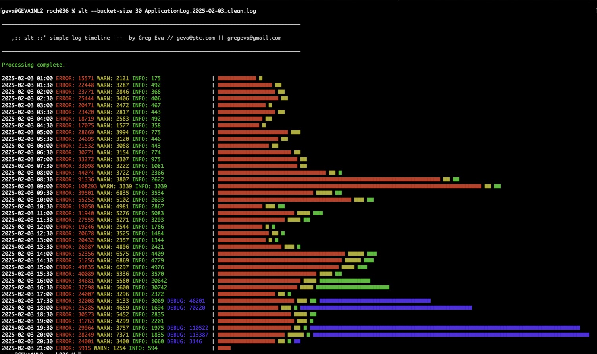
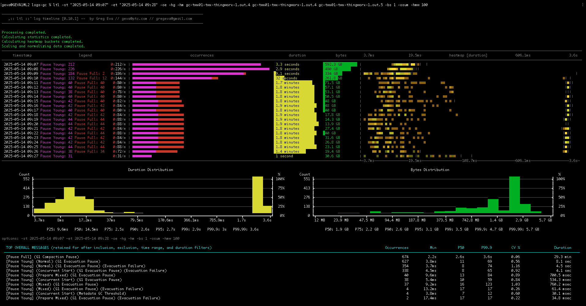

# ltl : Log Time Line

LogTimeLine (`ltl`) is a command-line log analysis tool that turns timestamped log files into visual timelines. Point it at an access log, application log, or GC log and it aggregates millions of lines into time-bucketed bar graphs, color-coded by severity, with per-bucket occurrence counts, latency statistics, and a ranked summary of the top contributing messages — all on a single screen in seconds.

The core of logtimeline's power is ad-hoc filtering combined with highlighting: filters shape the population under analysis, while highlighting visually isolates a subset within it. Include patterns to isolate what matters, exclude patterns to remove noise, and highlight to visually compare a subset against the full population — by regex pattern or by numeric thresholds on duration, size, or count — refined iteratively as the investigation evolves. This is something metrics systems fundamentally cannot do: you don't need to pre-define what you want to measure. The question is formed during the analysis, sharpened with each run, and changed direction as you learn. Slice, exclude, narrow, then highlight to see your target in the context of everything else.

The timeline is the anchor. Every feature — heatmaps, histograms, session tracking, thread pool activity, user-defined metrics — is a different lens on the same temporal axis. Start with a week of data in 2-hour buckets to spot anomalies, then zoom to millisecond precision over a 5-minute window to understand exact sequences. Switch from duration to byte analysis, examine percentile distributions, check thread pool saturation — each view reveals a different dimension of the same situation.

Unlike log management platforms, logtimeline works directly on files with no infrastructure, no retention limits, and no query timeouts. Download a single binary, point it at a log, and start investigating. It runs the same on a Linux container, a macOS laptop, or a Windows server. The analysis command line is shown on every run, making investigations reproducible and shareable.

For more on the design philosophy and intended workflow, see [Purpose and Design Philosophy](https://github.com/gregeva/logtimeline/wiki/Purpose-and-Design-Philosophy).

## Getting Started

1. Go to [Releases](https://github.com/gregeva/logtimeline/releases) and select the latest version
2. Download the binary for your platform and architecture
3. Rename the binary to `ltl` and place it somewhere in your `PATH`
4. On macOS, the binary is not signed — you will need to approve execution under **System Settings > Privacy & Security**

```bash
ltl [options] <logfile> [logfile2 ...]
```

## Documentation

See the [Usage Reference](https://github.com/gregeva/logtimeline/wiki) for the full options reference, feature explanations, and examples.

## Screenshots

Here is a very old screenshot showing the tools success in visualizing millions of log lines over a time range in a single screen.



### GC Analysis using Heatmap and Histogram

A Full GC loop explored through zooming in on the specific time range, activating heatmap with 100 character width, enabling duration and bytes histograms, and setting the time-window bucketing to 1 minute.



## Building from Source

### Install Dependencies

```bash
# macOS (requires Homebrew; installs Homebrew Perl, bash and Python, never the system ones)
./build/macos-setup.sh               # full setup; --dev-deps adds the profiler, --package PAR::Packer
./build/macos-setup.sh --validate    # run the environment check, change nothing
./build/macos-setup.sh --repair      # install nothing; add to the shell configuration only what the check finds missing

# Debian/Ubuntu (installs the distribution's packages with sudo apt-get)
./build/linux-setup.sh               # full setup; --dev-deps adds the profiler, --package PAR::Packer
./build/linux-setup.sh --validate    # run the environment check, change nothing
./build/linux-setup.sh --repair      # install nothing; report what a login shell finds (the distribution's tools need no shell configuration)
```

```powershell
# Windows, AMD64 or ARM64 (installs with WinGet; asks for administrator approval once)
powershell -NoProfile -ExecutionPolicy Bypass -File .\build\windows-setup.ps1              # full setup; --dev-deps adds the profiler, --package PAR::Packer
powershell -NoProfile -ExecutionPolicy Bypass -File .\build\windows-setup.ps1 --validate   # run the environment check, change nothing
powershell -NoProfile -ExecutionPolicy Bypass -File .\build\windows-setup.ps1 --repair     # install nothing; add to the Git Bash configuration only what is missing
```

On Windows the script installs Git, GitHub CLI, jq, Python with NumPy and SciPy, and Strawberry Perl, then configures Git Bash so `./ltl` runs from it with Strawberry Perl, in a terminal and in Claude Code's hooks alike. Clone with `git clone -c core.autocrlf=false` so scripts keep their LF line endings. Run `gh auth login` afterwards, and open a new terminal: a setting the script adds reaches only programs started after it.

#### Test-harness dependencies

The test harnesses, `ltl` and every other script take `perl`, `bash` and `python3` from PATH. Each host's setup installs the development versions of the three, never the system ones (on macOS, Homebrew's), and the environment check tests that they come first: on the PATH the check inherits, and in a login shell started from a clean environment. It reports each condition with what it expected and what it found, and changes nothing:

```bash
./build/macos-setup.sh --validate      # macOS
./build/linux-setup.sh --validate      # Debian/Ubuntu
perl process/check-environment.pl      # any host, with any Perl; the same check
```

On macOS, Homebrew's own `brew shellenv` line, which its installer asks you to add to `~/.zprofile`, is what puts its tools first in every login shell. If the check finds a login shell without it, `./build/macos-setup.sh --repair` adds it, once; it never rewrites a line already there.

A harness started under bash older than 4 stops at once, names the interpreter and points at the environment check. macOS's `/bin/bash` 3.2 would let a harness that crashes partway through report success. The system Perl lacks the modules `ltl` and the harnesses load.

Some test harnesses require Python 3, NumPy, and SciPy. A harness that needs one of these fails fast if it is missing, pointing at the environment check and at this section — it does not silently skip the work that depends on it.

**macOS:** `./build/macos-setup.sh` installs Homebrew Python with NumPy and SciPy (`brew install python numpy scipy`; Homebrew's NumPy and SciPy do not pull in Homebrew Python themselves). With Homebrew's line in the shell configuration, as above, `python3` is that Python, not the system one.

**Windows:** `build\windows-setup.ps1` installs Python 3.13 through WinGet with NumPy and SciPy. The WinGet Python has no `python3`, and Windows' own is a Microsoft Store stub that installs nothing, so the script writes `~/bin/python3`, a one-line wrapper that starts the WinGet Python; the environment check tests that it starts that Python.

**Linux:** `./build/linux-setup.sh` installs the distribution's NumPy and SciPy (`python3-numpy`, `python3-scipy`) for its own `python3`, and the distribution's package for each of the Perl modules `ltl` needs, so nothing is added to the shell configuration. A NumPy or SciPy installed with `pip` shadows the distribution's and fails the environment check.

### Build Static Binaries

```bash
./build/macos-package.sh arm64|x86_64    # macOS
./build/ubuntu-package.sh amd64|arm64    # Linux (requires Docker)
./build/windows-package.sh               # Windows (requires Docker + Wine)
```

### Run Directly from Source

```bash
./ltl [options] <logfile>
```

### Developer Setup

After cloning, activate the tracked pre-commit guard once:

```bash
./process/setup-hooks.sh
```

This sets `core.hooksPath` to `.githooks/` and enables `pre-commit`, which blocks accidentally staging Claude Code state (`.claude/`), secret-bearing files (`.env*`, `*.pem`, `*.key`, `id_rsa*`, `.netrc`, `.npmrc`, etc.), and content matching common token patterns. Override with `git commit --no-verify` only when you've verified the match is a false positive.

**Maintainer tools (occasional use):** History hygiene operations require `git-filter-repo`:

```bash
brew install git-filter-repo          # macOS
sudo apt-get install git-filter-repo  # Debian/Ubuntu
```

Not needed for normal development.

**Profiling tools:** performance work uses `Devel::NYTProf`, which is declared as a development-only dependency. Install it once:

```bash
./build/macos-setup.sh --dev-deps        # macOS
./build/linux-setup.sh --dev-deps        # Debian/Ubuntu
```

```powershell
powershell -NoProfile -ExecutionPolicy Bypass -File .\build\windows-setup.ps1 --dev-deps   # Windows (Strawberry Perl ships the profiler)
```

On macOS, run the same command after `brew upgrade perl`. Homebrew installs CPAN modules per Perl minor version, inside that version's own directory, so an upgrade leaves your modules behind rather than migrating them; nothing is broken, they simply are not visible to the new Perl.

Verify the install landed for the Perl that will run the profiler:

```bash
perl -MDevel::NYTProf::Data -e 'print "module ok\n"'
./tests/profile/profiling-preflight.sh
```

The first line checks the module. The second also checks that the HTML report tool resolves, which is the part that fails quietly: `cpanm` installs scripts into the Perl keg's own `bin`, which Homebrew does not put on your PATH.

A profiling run installs the tools itself if they are missing, and stops with the manual command if it cannot. See `features/nytprof-profiling-workflow.md` for how to profile.

## License

LogTimeLine is licensed under the [Apache License, Version 2.0](LICENSE).

You may use, modify, and redistribute it — including as part of a commercial
product — provided you retain the copyright notice, the license text, and the
[NOTICE](NOTICE) file, and state any changes you made. The license grants no
rights to the names "LogTimeLine" or "ltl", or to the name of the copyright
owner, for endorsing or promoting derived products.
